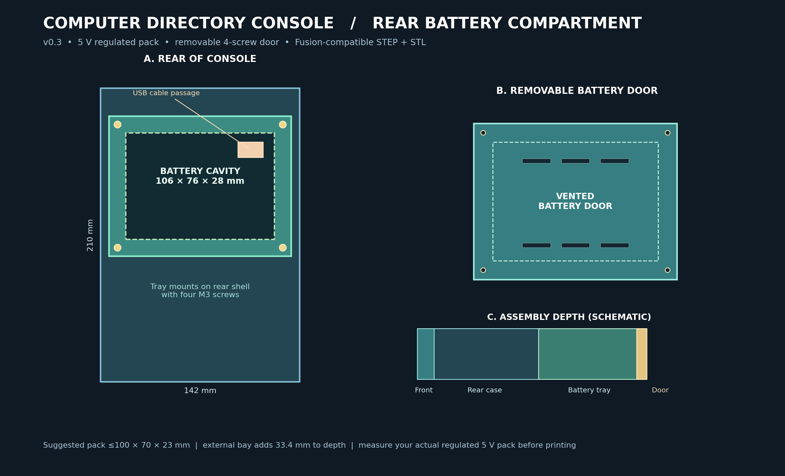
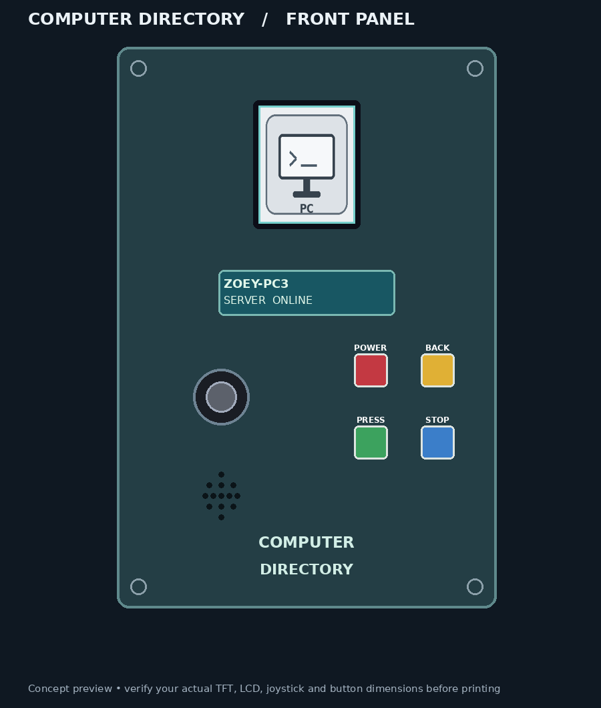
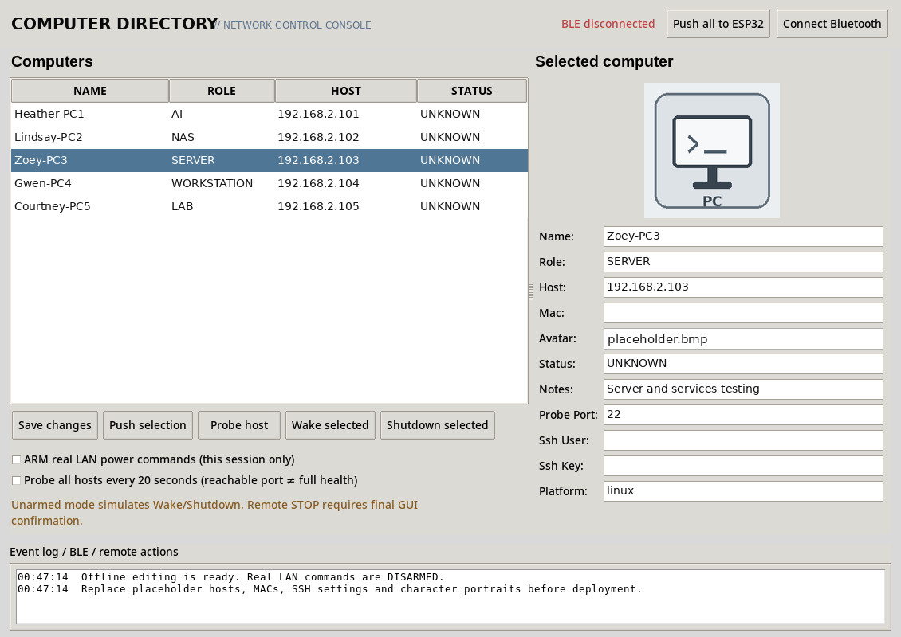
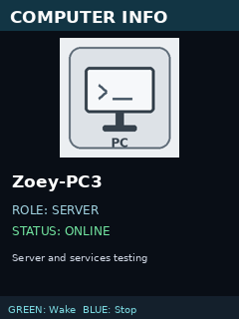
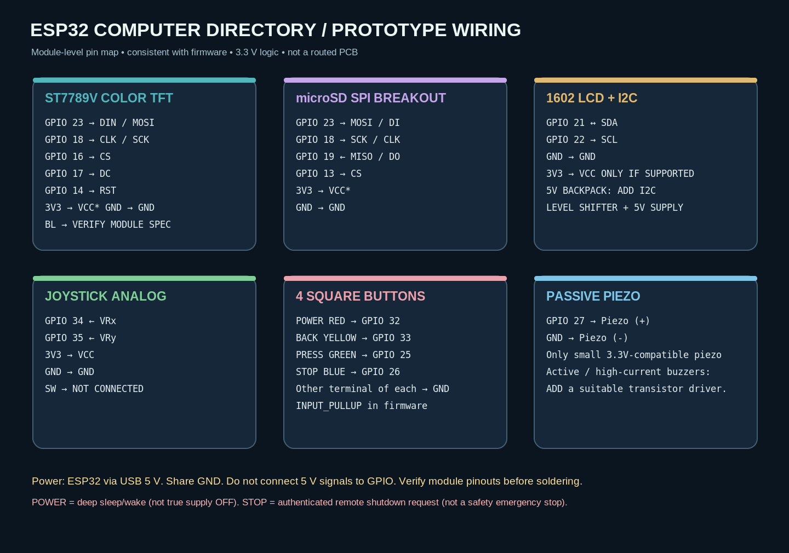

# HomeLab Computer Directory Console

**Prototype v0.5 (128-PC directory, streamed microSD images, GUI export workflow; includes v0.3 5 V battery-bay revision)** · ESP32 + ST7789V 240×320 + 16×2 I²C LCD + joystick + 4 square buttons + piezo + microSD + Bluetooth LE + Python desktop GUI.

## Current v0.5: 128-PC directory + streamed microSD images

The current revision supports **up to 128 computer records** in the ESP32 firmware, desktop GUI, and microSD exporter. The repository ships with **17 neutral demo records**, all using the same generic non-human placeholder image. The TFT shows a 9-row scrolling window rather than storing all images in RAM, and batch GUI sync writes `computers.csv` once per transfer. See [`README_128PC_UPGRADE.md`](README_128PC_UPGRADE.md) for the upgrade notes.

## Added in v0.4: image import + microSD export

Open the Python desktop GUI and use **Choose / replace image** to import your own JPG/PNG/WEBP/BMP picture. The GUI now creates a desktop PNG and an ESP32-readable **120×120 uncompressed 24-bit BMP**. Use **Export microSD files** to generate the exact card-root files from the saved GUI records. The `sd_card/` directory is also prebuilt with the neutral placeholder image. Image data **never transfers over BLE**; copy BMP files to the physical microSD. See [`docs/QUICKSTART_GUI_PORTRAITS_SD.md`](docs/QUICKSTART_GUI_PORTRAITS_SD.md) for exact steps and true power-button options.

## New in v0.3: removable rear 5 V battery compartment

This version adds an **external battery tray** and **screw-on ventilated door** to the original rear case, preserving the existing neutral front panel and all electronic controls. The tray is printed separately to avoid a large unsupported bridge in the rear shell. A generic **regulated 5 V battery/USB power bank** should be **no larger than approximately 100 × 70 × 23 mm**, including required cable clearance. Measure your particular pack before printing.

**New STL print set:** `stl/front_panel.stl` (unchanged), `stl/rear_shell_with_battery_mount.stl`, `stl/battery_tray_5V.stl`, `stl/battery_door_5V.stl`, and four optional `stl/square_button_trim.stl` pieces. Do **not** use the old `stl/rear_shell.stl` for the battery-backed version.

**Fusion import:** `cad/Console_Assembly_with_5V_Battery.step` or the individual STEP models. Source generator: `cad/make_modular_5V_battery_bay.py`. Full mechanical instructions and electrical cautions: [`docs/BATTERY_BAY_PRINT_AND_ASSEMBLY.md`](docs/BATTERY_BAY_PRINT_AND_ASSEMBLY.md).



> **Build status:** First-pass editable 3D CAD models and watertight STL meshes are generated. Python GUI runs locally. ESP32 firmware and an EAGLE/Fusion-compatible module-level schematic are supplied as source. **Not verified on your physical ESP32, display modules, buttons, or PCs.** Verify components and test on a breadboard before soldering or printing the final case.





## Features

- **17 editable demo computers**, with firmware/GUI capacity for **up to 128 records**. All bundled records use neutral example network data and the same generic placeholder image.
- **Neutral placeholder image** stored as `.png`, editable `.svg`, and **120 × 120, 24-bit `.bmp`** for the ST7789V. No character portraits are bundled.
- **240 × 320 TFT:** scrollable computer directory, image/detail page, shutdown confirmation, numeric password keypad (digits 1–9), selected-versus-all computer action, request status.
- **16 × 2 character LCD:** one-line state and selected-computer summary.
- **Joystick:** four-way selection, **SW push function unused**.
- **Four square buttons:** RED POWER, YELLOW BACK, GREEN PRESS, BLUE STOP.
- **Passive piezo:** navigation, invalid-action, error, success and confirmation sounds.
- **microSD:** cached directory and placeholder/device images; BLE-updated registry is saved to card.
- **Python GUI:** neutral project title, image placeholders, editable computer info, TCP status probes, BLE sync, guarded Wake-on-LAN and SSH shutdown.



## Get started

### 1. Desktop GUI without hardware

```bash
cd HomeLab
python -m pip install -r python_gui/requirements.txt
python python_gui/console_manager.py
```

Works as an offline directory manager without an ESP32. On Linux also install the system **Tk** package and enable Bluetooth service if using BLE. Python 3.10+ recommended. On Windows, use `py -m pip install -r python_gui/requirements.txt` and `py python_gui/console_manager.py`.

Choose a computer, edit its details, and press **Save changes**. The data lives in `assets/computers.json`. Click **Choose / replace image** to import a custom picture. Click **Export microSD files** to create updated files for the physical card. Click **Connect Bluetooth** only after the ESP32 firmware is flashed. `Push all to ESP32` transfers the records over BLE.

The supplied LAN addresses are examples, not your actual machines. Blank MAC and SSH fields intentionally prevent working power commands until configured. **Real remote power operations are DISARMED on every GUI launch** and require a second GUI confirmation even when requested by the ESP32.

### 2. Prepare the microSD

Format the 1 GB card as FAT16/FAT32 where supported. Copy these files **directly to the root** of the card:

```
/computers.csv
/placeholder.bmp
```

Use the contents of `assets/computers.csv` and `assets/avatars/*.bmp`. The BMP files are 24-bit uncompressed, 120×120 pixels. Replacements must use the same size/format or the firmware BMP decoder must be updated.

### 3. ESP32 firmware

In Arduino IDE, select the board corresponding to your **classic ESP32-WROOM-32 DevKit**. Install:

- **Adafruit GFX Library**
- **Adafruit ST7735 and ST7789 Library**
- **LiquidCrystal_I2C** compatible with `.init()` and `.backlight()`
- ESP32 Arduino board package, including SPI, SD, Wire, BLE

Open `firmware/DirectoryConsole/DirectoryConsole.ino`. Wire using the schematic and pin table below. Confirm voltage requirements of the exact screen modules first. Upload, open Serial Monitor at 115200, and test **one peripheral at a time**.

The firmware was authored for ESP32 Arduino and **has not been compiled or bench-tested against your specific board and libraries**. You may need to adjust the LCD I²C address, display rotation and joystick direction constants. Details: [`docs/TECHNICAL_RUNBOOK.md`](docs/TECHNICAL_RUNBOOK.md).

### 4. Enclosure and Fusion

- Import [`cad/Console_Assembly.step`](cad/Console_Assembly.step) into Autodesk Fusion for the 3D assembly.
- Or import individual editable solids: `cad/front_panel.step`, `cad/rear_shell.step`, `cad/square_button_trim.step`.
- STLs in `stl/` are printable meshes: `front_panel.stl`, `rear_shell.stl`, `square_button_trim.stl` (print **4×**, optional).
- Fusion Electronics can import the EAGLE-style module schematic: `schematics/Directory_Interconnect.sch`.
- `cad/front_panel_layout.dxf` is an editable 2D sketch reference, and `cad/generate_enclosure.py` is the parameterized CadQuery source.

**Important:** Native Autodesk `.f3d` archives are **not provided**. The supplied STEP and EAGLE `.sch` formats are intended for Fusion import, but actual Fusion import of the `.sch` has not been tested here. The .sch documents module connections, not a validated custom PCB. The shell uses **nominal** holes and generic mounting arrangements. Exact fit is not guaranteed until you measure your boards, switches, and connectors.

For details and print settings: [`docs/FUSION_AND_PRINTING.md`](docs/FUSION_AND_PRINTING.md).

## Wiring overview



| Signal / part | ESP32-WROOM GPIO |
| --- | --- |
| TFT DIN and SD MOSI | 23 (shared) |
| TFT CLK and SD SCK | 18 (shared) |
| SD MISO | 19 |
| TFT CS / DC / RST | 16 / 17 / 14 |
| SD CS | 13 |
| 16×2 I²C SDA / SCL | 21 / 22 |
| Joystick VRx / VRy | 34 / 35 |
| RED POWER / YELLOW BACK | 32 / 33, switches to GND |
| GREEN PRESS / BLUE STOP | 25 / 26, switches to GND |
| Passive piezo + / − | 27 / GND |

TFT, 3.3 V-compatible SD adapter and joystick use **3.3 V logic**; all grounds join. TFT `BL` depends on the actual breakout and is **deliberately unspecified** until you check its rating. A common 16×2 I²C backpack often runs at **5 V** and pulls SDA/SCL to 5 V; this requires an **I²C level shifter** to protect the ESP32, unless you have confirmed a 3.3 V-compatible module. Do **not** plug 5 V signals directly into ESP32 GPIO.

**POWER vs STOP distinction:** Red POWER enters ESP32 deep sleep after a long press and wakes via its RTC-capable GPIO; the LCD backlight is requested off before sleeping, while TFT BL hardwired to 3.3V remains illuminated. It does **not** electrically cut power. A true momentary soft-latch power switch requires additional hardware. Blue STOP is a **password-protected, remote graceful shutdown request**, not an industrial emergency-stop or physical disconnect.

## On-device controls

| Button | Action |
| --- | --- |
| Red POWER (hold 1.2 s) | ESP32 deep sleep; press again to wake (power remains supplied) |
| Yellow BACK | Previous menu, or error chirp if already at directory root |
| Green PRESS | Open computer; request its WAKE on detail screen; choose PIN digit or confirmation |
| Blue STOP | Confirm request → 1–9 PIN keypad (`1234` demo) → Selected PC or ALL → request manager action |
| Joystick UP / DOWN | Scroll directory, keypad rows, or scope |
| Joystick LEFT / RIGHT | PIN keypad columns or yes/no confirmation |

After the console sends `REQ|0|WAKE` or `REQ|ALL|STOP`, the **Python desktop manager** must be running and connected over Bluetooth. It will simulate by default. An operator must explicitly arm real LAN commands and approve each action in the GUI. A disconnected console must **not** claim success.

## Status and remote power limits

- **ONLINE** means a configured TCP service was reachable. A failed probe becomes **UNVERIFIED**, never automatically OFF: a blocked port or firewall does not prove a machine is off.
- **Wake-on-LAN** needs a valid MAC address and motherboard/NIC/BIOS + network support. Sending a magic packet does not prove the system started.
- **Shutdown** uses existing **OpenSSH** access to each host. Linux default is `sudo -n /usr/bin/systemctl poweroff` (explicit narrow privilege configuration required), and Windows with OpenSSH uses `shutdown /s /t 0` (appropriate permission required).
- Real shutdown is disabled until the GUI operator actively checks **ARM real LAN power commands** and confirms the exact target(s) at execution time.
- Test PIN `1234`, unencrypted demo BLE, and unauthenticated UID/list entries are **not secure enough for production**. Secure BLE pairing and per-operator authorization are future requirements.

## Repository layout

```text
HomeLab/
├── README.md
├── ROADMAP.md
├── LICENSE
├── requirements-dev.txt
├── .gitignore
├── .github/workflows/tests.yml
├── docs/
│   ├── TECHNICAL_RUNBOOK.md
│   ├── FUSION_AND_PRINTING.md
│   └── BOM.csv
├── firmware/DirectoryConsole/DirectoryConsole.ino
├── python_gui/
│   ├── console_manager.py
│   ├── ble_link.py
│   ├── remote.py
│   └── requirements.txt
├── assets/
│   ├── computers.csv
│   ├── computers.json
│   ├── make_avatars.py
│   └── avatars/placeholder.{svg,png,bmp}
├── cad/
│   ├── Console_Assembly.step
│   ├── front_panel.step
│   ├── rear_shell.step
│   ├── square_button_trim.step
│   ├── front_panel_layout.dxf
│   └── generate_enclosure.py
├── stl/
│   ├── front_panel.stl
│   ├── rear_shell.stl
│   └── square_button_trim.stl
├── schematics/
│   ├── Directory_Interconnect.sch
│   ├── wiring_overview.svg
│   ├── pin_map.csv
│   └── generate_schematic.py
├── previews/
│   ├── enclosure_front_preview.png
│   ├── python_gui_preview.png
│   ├── display_zoey_example.png
│   └── wiring_overview.png
└── tests/
    ├── test_project.py
    └── test_media_tools.py
```

## Placeholder assets

The computer names, roles, example addresses, and descriptions are placeholder/demo content used for testing the interface. Only a generic non-human placeholder image is bundled. Replace network values before real deployment. Do not commit real MAC addresses, SSH usernames, private keys, passwords, or security tokens. This project is licensed under the Apache License 2.0; see [`LICENSE`](LICENSE).

## Development status and roadmap

Software-side unit tests run in GitHub Actions and cover the registry, image export, protocol framing, schematic parsing, and printable mesh integrity. Physical ESP32/BLE/display integration is still a prototype and must be validated on the target hardware before deployment.

Planned work is tracked in [`ROADMAP.md`](ROADMAP.md). The roadmap contains more than 20 hours of intended engineering work across hardware validation, authenticated BLE, safer remote-control permissions, enclosure fit testing, tests, and documentation.

## Build milestone order

1. Prove TFT and 1602 I²C LCD independently (including I²C voltage safety).
2. Prove microSD reads one BMP on the TFT.
3. Wire joystick, four buttons and piezo; test each with Serial Monitor.
4. Flash combined firmware; verify directory, placeholder image, keypad and console STOP request **with manager unarmed**.
5. Start GUI offline; edit data and save; test BLE connection and sync.
6. Configure harmless TCP status probes and a single test Wake-on-LAN target.
7. Configure a noncritical lab host for SSH shutdown; test only with authorization and GUI confirmation.
8. Measure exact board/switch dimensions; print first-fit front/rear enclosure, correct CAD as required, then solder and mount.

> **No hardware has been remotely powered, shut down or physically tested by this build package.**
